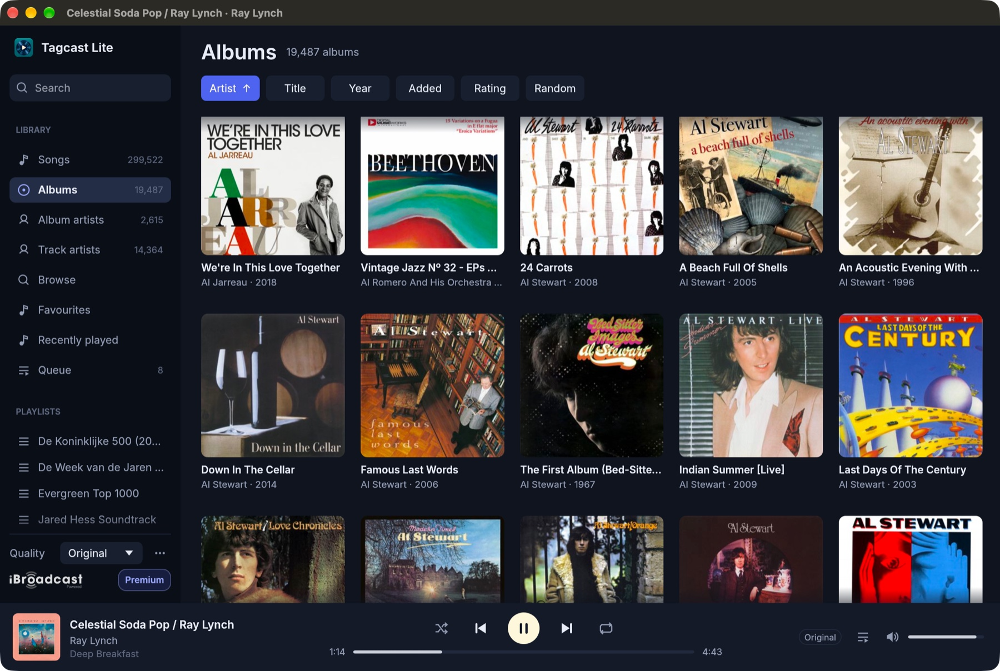
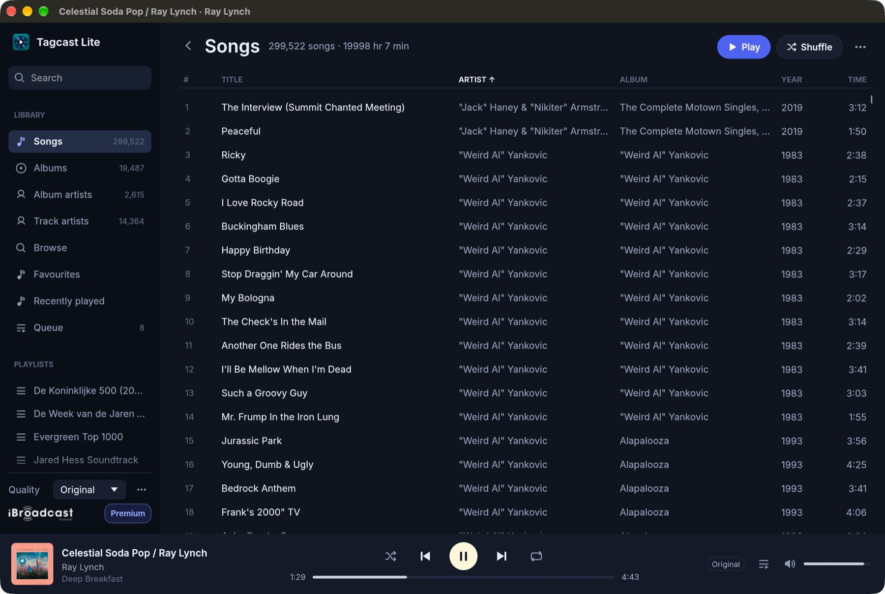
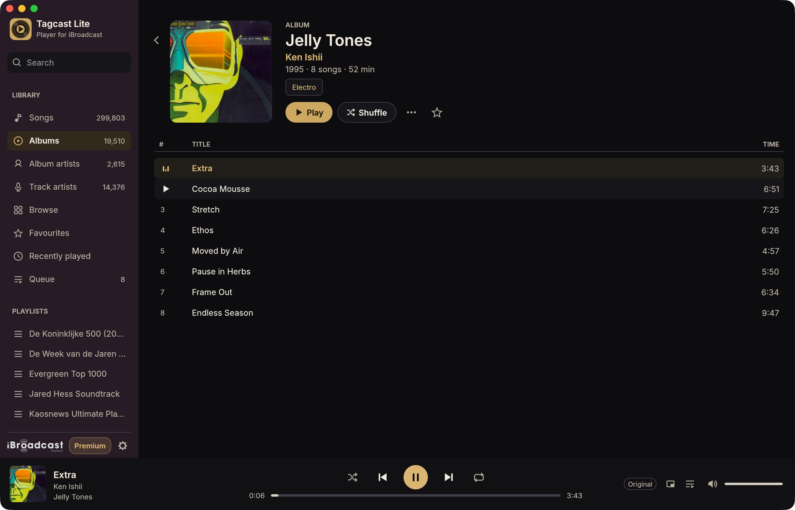
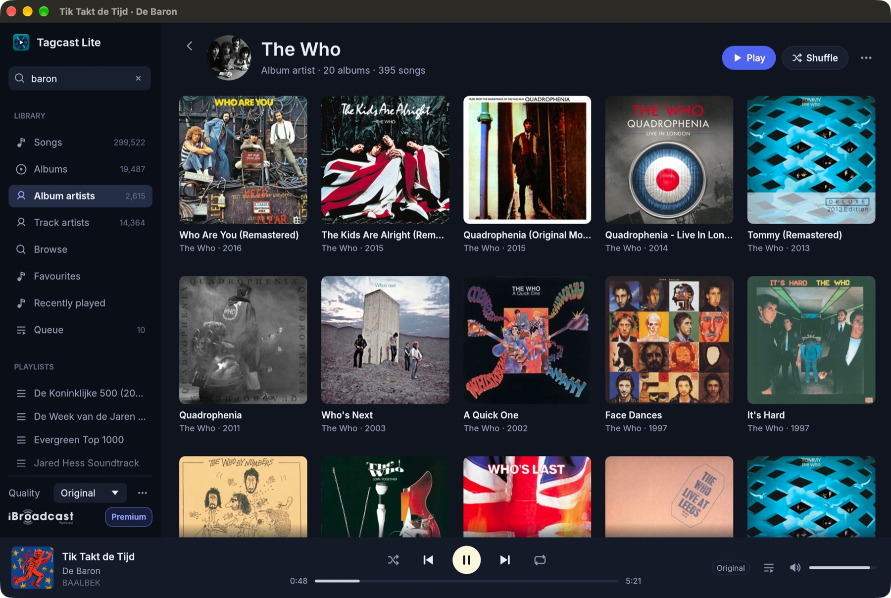
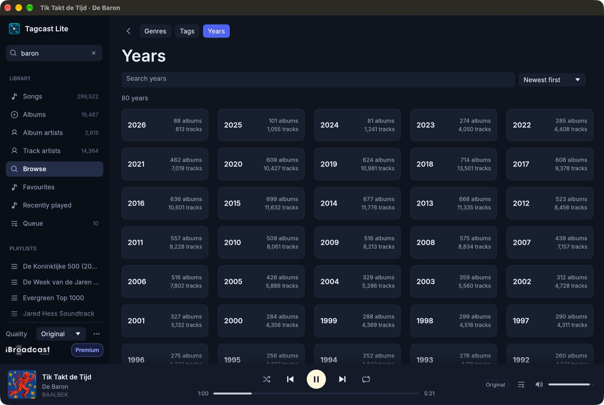
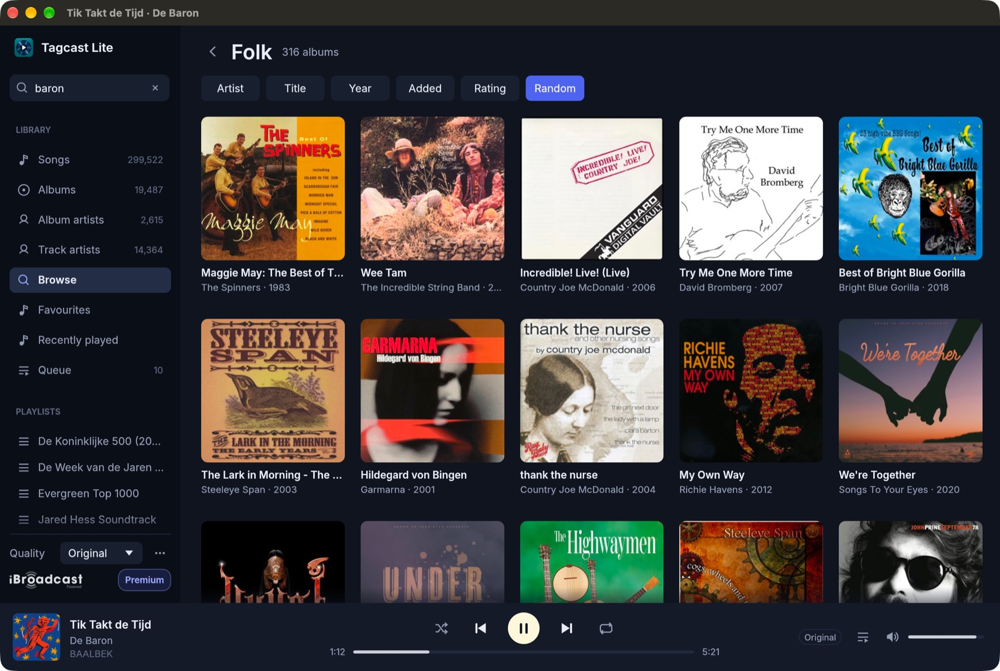
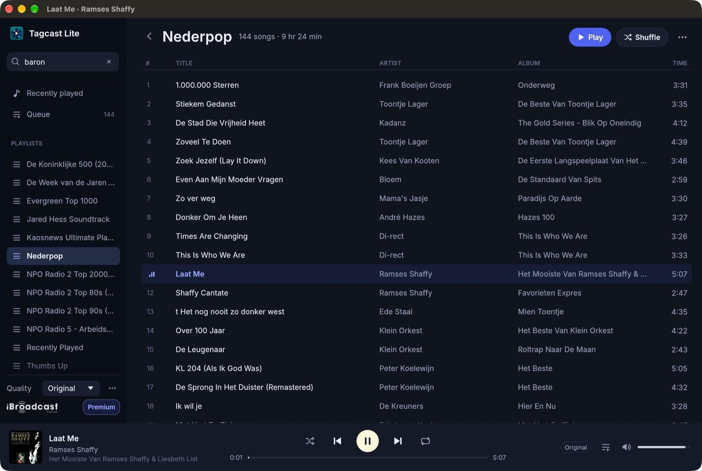

# Tagcast Lite

<p align="center"><b>Lightweight desktop player for iBroadcast.</b></p>
<p align="center">
  <picture>
    <source media="(prefers-color-scheme: dark)" srcset="assets/ibroadcast-dark-compact-powered.svg">
    
  </picture><br>
  <small>Independent app by Cyberdelia</small>
</p>
<p align="center">
  <a href="https://github.com/cyberdeliaAI/tagcast-lite/actions/workflows/build.yml"></a>
  <a href="LICENSE"></a>
</p>

Tagcast Lite brings your [iBroadcast](https://www.ibroadcast.com/) music library,
queue and playback controls together in one native, read-only player. Downloads
include the player and audio decoders. First-time sign-in opens in your browser.

## Download and install

Choose a package from the [latest GitHub release](https://github.com/cyberdeliaAI/tagcast-lite/releases/latest).
The release includes SHA-256 checksums for the four archives.

| Platform | Requirements | Install and open |
| --- | --- | --- |
| macOS | Apple Silicon or Intel, macOS 11 or later. Release builds are tested on macOS 15. | Extract the matching ZIP, move **Tagcast Lite.app** to Applications, and open it. Both builds are Developer ID signed and notarized by Apple. |
| Windows | 64-bit Windows on x64 with the [Microsoft Visual C++ v14 Redistributable (x64)](https://learn.microsoft.com/en-us/cpp/windows/latest-supported-vc-redist). | Extract the ZIP and open `tagcast-player.exe`. The executable is unsigned, so Windows may show a SmartScreen prompt. |
| Linux | x86-64 with glibc 2.39 or later, a graphical desktop with OpenGL, and the ALSA, D-Bus, OpenSSL 3, and XKB runtime libraries. Ubuntu 24.04 is the release build and test environment. | Extract the TAR.GZ and run `./tagcast-player` from the extracted directory. |

### Homebrew on macOS

With [Homebrew](https://brew.sh/) installed, run:

```sh
brew install --cask cyberdeliaAI/apps/tagcast-lite
```

Homebrew selects the matching Mac download and verifies its checksum. Open
**Tagcast Lite** from Applications. If you installed the app manually, quit it and
move it aside before installing through Homebrew. To update, quit the app and run:

```sh
brew upgrade --cask cyberdeliaAI/apps/tagcast-lite
```

The cask is maintained in the [Cyberdelia Homebrew tap](https://github.com/cyberdeliaAI/homebrew-apps).

## Screenshots



<details>
<summary>More screenshots</summary>

### Songs



### Album



### Album artist



### Years



### Genre



### Playlist



</details>

## Using it

Click **Sign in with iBroadcast** to get an iBroadcast device code. Click
**Open iBroadcast**, enter the code and approve. The player only asks for
library and account read access. After that it opens straight into your
library from a verified, account-bound local copy and checks iBroadcast for changes in the background. Older sign-ins are bound to their account after their first successful status response.

When upgrading from 0.3.6 or earlier, sign in once to authorize Tagcast Lite's
own iBroadcast registration. Use the same iBroadcast account to access your
locally saved favourites, queue and listening history.

- **Sidebar:** Songs, Albums, Album artists, Track artists, Queue and playlist folders. Browse by
  genre, tag or year, see favourites, or return to recently listened tracks.
  Search finds artists, albums and songs as you type.
- **Artist views:** Album artists shows album credits and Track artists shows
  the performers credited on songs. Cards open the albums for that role. Play
  on a track artist page queues that artist's credited songs. Both views have
  search, Name and Random sorting, and iBroadcast portraits where available.
  Click Name again to reverse the order, or Random to reshuffle.
- **Albums:** click a cover to open it. Hover a cover and click its
  play button to play it right away.
  Multi-disc sets have one cover and a
  section for each disc. Play follows disc and track order. Lite uses combined
  sets returned by iBroadcast and can group matching separate discs locally.
  The Albums sort buttons switch between
  artist, title, release year, date added, iBroadcast rating and random order.
  Click the active sort again to reverse it or reshuffle. Each change returns
  to the top of the grid. Date Added and Rating show the values below the covers.
- **Browse:** Genres, Tags and Years have searchable cards with album and
  track counts. Open a card to browse or play the matching albums.
- **Songs:** double-click to play from that song. Right-click for Play next,
  Add to queue, Go to album and Go to artist. Click a column header in Songs
  to sort.
- **Play and Shuffle** on an album, artist or playlist page replace the queue.
  The ⋯ button next to them adds everything to the queue instead.
- **Now-playing bar:** shuffle, previous, play/pause, next and repeat (off,
  all, one). Click or drag the position bar to seek. Click the title or artist
  to open the album or artist. The queue button opens a side panel on wide
  windows. System media controls receive track details and the playback clock.
- **Listening:** the queue is restored per account and waits for Play. The
  player records tracks locally after ten seconds of output. Mark local album
  favourites on the album page.
- **Quality:** 128 kbps is the default. With Premium, the menu at the bottom
  left offers 96, 192, 256 and 320 kbps and Original. A change restarts the
  current track at the same position.

Volume, quality, shuffle, repeat, album and artist sort, and the window size are remembered.

### Keyboard

| Key | Action |
| --- | --- |
| Space | Play or pause |
| ← / → | Seek 10 seconds |
| ⌘← / ⌘→ | Previous or next track |
| ⌘↑ / ⌘↓ | Volume |
| ⌘F | Search |
| Esc | Clear the search or go back |
| ⌘R | Reload the library |

On Linux, use Ctrl instead of ⌘.

### Command line

`--client-id ID` (or `IBROADCAST_CLIENT_ID`) selects a custom public OAuth
client. `--logout` removes the player's stored sign-in and library snapshot for
that client. **Sign out** in the ⋯ menu at the bottom left does the same from
the window. The full Tagcast app uses separate credentials and settings.

## Playback

The player streams audio into memory. It uses HTTP byte ranges when available.
A complete non-range stream is seekable from a bounded in-memory copy. If the
stream is still incomplete or exceeds the copy budget, the player stays where it
is and shows that the position is not yet available. Premium HLS supports the
iBroadcast MPEG-TS/AAC path and falls back to the direct stream of the same
bitrate when the segmented route fails. A temporary network interruption gets
one automatic recovery for the current track. Original may switch to 128 kbps
when the source or decoder rejects that format. The now-playing bar shows the
stream in use and any switch.

The sidebar menu offers an experimental **Gapless · Original FLAC** choice,
off by default. It applies to ordered album playback with compatible mono or
stereo FLAC tracks. The first track starts immediately. A bounded lookahead
prepares the following track and uses the same output and resampler through the
boundary. An unavailable or incompatible next track uses the ordinary transition.
The stream badge shows the decoded and output rates. Use **Reconnect audio
output** after switching speakers, headphones or a DAC. This opens the current
system output and leaves the track paused at its current position.

## Build and check

You need Rust 1.95 or newer (`rustup update`) and, on macOS, Apple's Command Line
Tools.

```sh
cargo build --locked --release
cargo test --locked
./target/release/tagcast-player
```

To get a double-clickable `Tagcast Lite.app` with the Tagcast icon:

```sh
scripts/make-macos-app.sh
open "target/release/Tagcast Lite.app"
```

The script signs the app ad hoc. Set `CODESIGN_IDENTITY` to your Developer ID
Application identity to sign it with that instead.

The Native builds workflow builds and packages Apple Silicon, Intel macOS, Windows
x64 and Linux x64. Pull requests and manual runs validate the packages. Pushing a
version tag matching `Cargo.toml` signs and notarizes the macOS apps and publishes
all four archives and their checksums as a GitHub Release. The macOS release
job uses the repository's `CSC_LINK` (a base64-encoded Developer ID Application
PKCS#12), `CSC_KEY_PASSWORD`, `APPLE_ID`, `APPLE_APP_SPECIFIC_PASSWORD` and
`APPLE_TEAM_ID` secrets.

On Linux install the ALSA, D-Bus, OpenSSL, XKB and OpenGL development libraries.
Linux stores credentials in a private file under
`$XDG_DATA_HOME/tagcast-player` and uses MPRIS for desktop controls. Windows
stores credentials in Windows Credential Manager. The player keeps its preferences
with its local library data and imports preferences from earlier installations on
first use.

### Playback checks

```sh
cargo build --locked --release --example playback_checks
python3 -B tests/playback_fixture.py target/release/examples/playback_checks
```

These need FFmpeg and Python. They use temporary synthetic audio and a loopback
HTTP server. CI runs the Linux checks with `--skip-device --soak 5 --synthetic-hours 0.02`.
The report measures Play to the first decoded frames scheduled by
CoreAudio with the output muted and a fixed 40 ms fixture delay on the initial
HTTP response. RSS samples cover the playback process and its frameworks, with
no live library loaded. The accelerated run drains the same PCM queue into a test
sink and reports elapsed audio separately from wall time.

### Working on the interface

Debug builds can open a saved iBroadcast library response without signing in:

```sh
TAGCAST_PLAYER_FIXTURE=library.json \
TAGCAST_PLAYER_FIXTURE_AUDIO=http://127.0.0.1:8000/tone.wav \
TAGCAST_PLAYER_FIXTURE_ART=http://127.0.0.1:8000 \
cargo run
```

Every track then plays the given loopback file and covers load from
`<art server>/artwork/<id>-300`. `TAGCAST_PLAYER_FIXTURE=signin` shows the
sign-in screen with a sample code. Release builds leave all of this out.

## Credits

Tagcast Lite is an independent player for iBroadcast. The Powered by iBroadcast
badge is provided under the [iBroadcast branding guidelines](https://help.ibroadcast.com/en/developer/branding).

The interface uses [egui](https://github.com/emilk/egui) and the
[Inter](https://rsms.me/inter/) typeface (SIL Open Font License, see
`assets/fonts/Inter-LICENSE.txt`).
